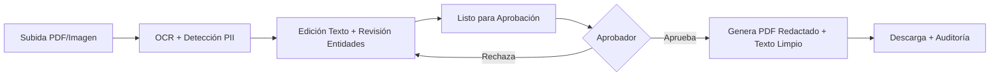

# Especificación Funcional - Legal Redactor iCAT

## 1. Visión General

Aplicación web para la anonimización de documentos legales/médicos con flujo de revisión humana y aprobación. Diseñada para el personal de iCAT que transcribe y revisa documentos.

## 2. Actores y Roles

| Rol | Descripción | Permisos |
|-----|-------------|----------|
| **Transcriptor/Revisor** | Corrige OCR, revisa entidades detectadas, marca "Listo para aprobación" | Subir docs, ver asignados, editar entidades, enviar a aprobación |
| **Aprobador** | Revisa versión final, aprueba o rechaza con comentarios | Ver docs listos, aprobar/rechazar, descargar PDF/texto |
| **Admin** | Gestiona reglas, usuarios, auditoría | CRUD reglas, usuarios, ver auditoría completa |

## 3. Flujo Principal (User Journey)

### 3.1. Subida de Documento
- Drag & drop o click para seleccionar
- Validación: PDF, PNG, JPG, TIFF (máx 50MB)
- Asignación automática al usuario que sube (transcriptor)
- Cola de procesamiento asíncrono

### 3.2. OCR y Detección PII
- **OCR**: PaddleOCR (español/catalán) + PyMuPDF para PDFs nativos
- **PII Detection**: Microsoft Presidio + spaCy `es_core_news_lg` + recognizers custom (DNI, NIE, CIF, CIP, etc.)
- **Reglas configurables**: Motor de reglas versionado en BD (JSON)
- **Resultado**: Texto completo + entidades con bbox (coordenadas PDF) + acción por defecto según regla

### 3.3. Revisión Humana (Interfaz Transcriptor)
- **Vista dividida**: PDF original (izquierda) + lista entidades (derecha)
- **Sincronización bidireccional**: Click en entidad → scroll PDF a bbox; Click en bbox → highlight entidad
- **Estados entidad**: 🔴 Pendiente | 🟡 En revisión | 🟢 Confirmada
- **Acciones por entidad**: Retirar / Generalizar / Pseudonimizar / Mantener / Editar texto
- **Atajos teclado**: J/K navegar, R retirar, M mantener, G generalizar, S guardar
- **Validación**: No se puede enviar a aprobación si hay entidades pendientes

### 3.4. Aprobación (Interfaz Aprobador)
- **Solo lectura**: PDF redactado preview + texto limpio preview
- **Resumen**: Contadores por acción (retiradas, generalizadas, mantenidas, pseudonimizadas)
- **Decisión**: Aprobar (genera exports) | Rechazar (comentario obligatorio → vuelve a transcriptor)
- **Trazabilidad**: Quién aprobó, cuándo, qué reglas versión

### 3.5. Exportación
- **PDF Redactado**: Cajas negras quemadas (PyMuPDF `apply_redactions` - irrecuperable)
- **Texto Limpio**: .txt con sustituciones aplicadas
- **Log Auditoría**: JSON con todas las decisiones, timestamps, usuarios

## 4. Reglas de Retirada (Configurables por Admin)

| Categoría | Entidades | Acción por defecto | Configurable |
|-----------|-----------|-------------------|--------------|
| **Identificadores directos** | DNI, NIE, NIF, CIF, PASAPORTE, TARJETA SANITÀRIA | RETIRAR | Sí |
| **Cuasi-identificadores** | Nombre, apellidos, teléfono, email, dirección, fecha nac. | RETIRAR | Sí |
| **Datos clínicos sensibles** | Diagnósticos CIE-10, medicación | MANTENER | Sí |
| **Fechas** | Ingreso, alta, nacimientos | GENERALIZAR (solo año) | Sí |
| **Profesionales** | Médico firmante, centro | PSEUDONIMIZAR (Dr. X, Centro Y) | Sí |
| **Administrativos** | Nº expediente, colegiado | MANTENER / PSEUDONIMIZAR | Sí |

**Formato regla**: `{id, nombre, entidad_presidio, patrón_regex_opcional, acción: retirar|generalizar|pseudonimizar|mantener, config: {}, activa, versión, created_by, created_at}`

## 5. Criterios de Aceptación (Testing)

| ID | Caso de Prueba | Resultado Esperado |
|----|----------------|-------------------|
| **F-01** | Subir PDF 5 páginas con DNI, nombres, teléfonos | OCR extrae texto + bboxes; Presidio detecta ≥95% entidades críticas |
| **F-02** | Transcriptor corrige "García" → "García López" | Cambio en historial; entidad PERSON actualiza bbox |
| **F-03** | Marcar diagnóstico CIE-10 como "Mantener" | No se tacha en PDF final; log registra decisión + user |
| **F-04** | Aprobador pulsa "Aprobar" | Genera PDF con cajas negras + texto plano; estado = APROBADO; inmutable |
| **F-05** | Aprobador rechaza: "Falta tachar teléfono p.3" | Vuelve a transcriptor; estado = RECHAZADO; notificación |
| **F-06** | Editar texto ya aprobado | Bloqueado o crea nueva versión v2 con nuevo ciclo completo |
| **F-07** | Exportar PDF → abrir en Adobe → buscar DNI | 0 resultados (texto quemado, no capa superpuesta) |
| **F-08** | Auditoría: filtrar por user, fecha, documento | Log completo: quién subió, corrigió, revisó, aprobó, qué reglas |
| **F-09** | PDF nativo (texto seleccionable) | Usa extracción nativa PyMuPDF (instantáneo, 100% precisión, bboxes exactos) |
| **F-10** | PDF escaneado + OCR | PaddleOCR 300 DPI; confianza media > 85% |

## 6. Requisitos No Funcionales

| Requisito | Especificación |
|-----------|----------------|
| **Seguridad** | Datos nunca salen del servidor (on-premise); HTTPS obligatorio; JWT + Keycloak OIDC |
| **Privacidad** | Cumplimiento GDPR/LOPD; redacción certificada (NIST); auditoría inmutable |
| **Rendimiento** | OCR < 30s/página; API < 200ms p95; soporte 10 usuarios concurrentes |
| **Disponibilidad** | 99.5% uptime; backup diario + PITR; recovery < 15 min |
| **Accesibilidad** | WCAG 2.1 AA; navegación teclado; screen readers |
| **Navegadores** | Chrome/Edge/Firefox últimos 2 versiones |

## 7. Métricas de Calidad IA

| Métrica | Objetivo | Medición |
|---------|----------|----------|
| **Recall DNI/NIE/CIF** | > 99% | Dataset 200 docs iCAT anotados |
| **Recall PERSON** | > 95% | + gazetteer nombres INE |
| **Precision global** | > 95% | Thresholds por entidad tunados |
| **F1 crítico** | > 97% | DNI + Nombre + Tel + Email |
| **Tiempo OCR/página** | < 30s CPU | PaddleOCR mobile v3 |

---

*Documento vivo - Actualizar en cada sprint*
